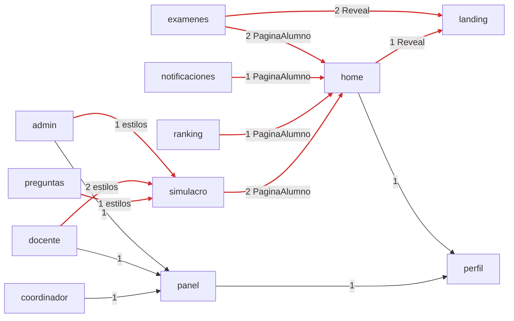
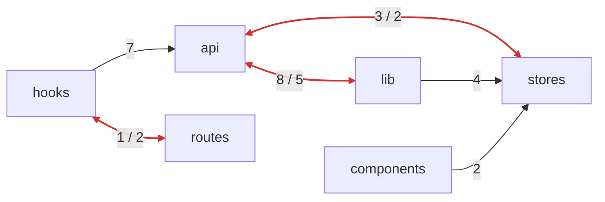

# Fase 0 — Diagnóstico de features (frontend)

Fecha: 2026-10-24. Commit medido: `6d6cba8` (rama `feat/listening-revision-y-docs`), antes de cualquier
cambio de esta refactorización. Solo lectura.

**Cómo se midió:** se resolvieron todos los imports relativos de `src/` (`from '…'`, `import '…'`,
`import('…')`) y se agruparon por **zona**: cada carpeta de `src/` (`api`, `lib`, `hooks`…) es una
zona, cada `features/<x>` es una zona propia, y los archivos sueltos de `src/` (`main.tsx`,
`App.tsx`, `router.tsx`) son `root`. Se usó la lógica del test propio `src/arquitectura.test.ts` (reemplazado en la fase 3).

## 1. Zonas y features que existen hoy

| Zona | Responsabilidad |
|---|---|
| `api/` | Un cliente por recurso del backend (`*Api.ts`), sus tipos y `client.ts` (fetch + sobre de errores). Capa horizontal compartida. |
| `stores/` | Estado global Zustand: sesión (`authStore`) y conexión (`conexionStore`). |
| `lib/` | Utilidades: formato, HTML seguro, iconos, `queryClient`, reglas de calificación, programas. **Además** la sesión (`sesion.ts`), que llama al backend. |
| `hooks/` | `useAuth`, catálogos compartidos (`useCatalogos`) y contador de no leídas. |
| `components/` | Kit de UI (`components/ui`), `Avatar`, `BannerConexion`, `InfoTooltip`. |
| `routes/` | Guardas de ruta (`RutaProtegida`, `RutaPorRol`) y **el contexto de los layouts** (`contextoLayout.ts`). |
| `test/` | `renderConQuery` para tests. |
| `features/` | 14 features: `admin`, `auth`, `coordinador`, `docente`, `examenes`, `home`, `landing`, `notificaciones`, `panel`, `perfil`, `preguntas`, `ranking`, `simulacro`. |

### Lo que *debería* existir según el dominio

| Pieza | Hoy | Problema |
|---|---|---|
| Layout de página del alumno (`PaginaAlumno`, `CLASE_CTA`) | Dentro de `features/home` | La usan 5 features: `examenes`, `notificaciones`, `ranking`, `simulacro` y `home`. Es UI compartida. |
| Animación de entrada (`Reveal`) | Dentro de `features/landing` | La usan `examenes` y `home` además de la landing. |
| Estilos del HTML de enunciados (`CLASE_HTML_ENRIQUECIDO`, `LETRAS`) | `features/simulacro/estilosSimulacro.ts` | La usan `admin`, `docente` y `preguntas`. |
| Contexto de los layouts (`useContextoLayout`) | `routes/` | Es un hook. Por estar en `routes`, `hooks` y `routes` se importan mutuamente. |
| Sesión contra el backend (`sesion.ts`) | `lib/` | Llama a la API y usa los stores, así que `lib` deja de ser una capa base. Forma el ciclo `api ↔ lib`. |
| API pública de cada feature | No existe (`index.ts`) | `admin`, `docente` y `coordinador` importan `panel/PanelLayout` por dentro, y `home` y `panel` hacen lo mismo con `perfil/ConfiguracionModal`. |

## 2. Grafo real de dependencias

### 2.1 Entre features

Solo flechas `feature → feature`. Todas las features dependen además de `api`, `components`,
`hooks`, `lib` y `test`, lo que es correcto. En **rojo** están las que entran a una feature para
usar algo que en realidad es compartido.

### 2.2 Entre zonas compartidas (ciclos)

- `api → lib`: `queryClient`, `reglasCalificacion` y `sesion`. `lib → api`: `sesion.ts` (authApi, config) y `programas.ts` (tipo `TipoPrograma`).
- `api → stores`: `client.ts` lee el token y monitorea la conexión. `stores → api`: `authStore` importa el **tipo** `Usuario` de `authApi`.
- `hooks → routes`: `useNoLeidas` usa el tipo `ContextoLayout`. `routes → hooks`: las guardas usan `useAuth`.

## 3. Problemas encontrados

| # | Tipo | Dónde | Imports | Detalle |
|---:|---|---|---:|---|
| 1 | UI compartida dentro de una feature | `features/home/PaginaAlumno.tsx` | 6 | 4 features entran a `home` para usarla. |
| 2 | UI compartida dentro de una feature | `features/landing/Reveal.tsx` | 3 | `examenes` y `home` dependen de `landing`. |
| 3 | Estilos compartidos dentro de una feature | `features/simulacro/estilosSimulacro.ts` | 4 | `admin`, `docente` y `preguntas` dependen de `simulacro`. |
| 4 | Ciclo `hooks ↔ routes` | `routes/contextoLayout.ts` | 1 / 2 | Además `home` y `notificaciones` importan de `routes`. |
| 5 | Ciclo `api ↔ lib` | `lib/sesion.ts` | 8 / 5 | Lógica de sesión con red en la capa de utilidades. |
| 6 | Ciclo `api ↔ stores` (solo de tipos) | `stores/authStore.ts` | 3 / 2 | El tipo `Usuario` vive en `api/authApi.ts`. |
| 7 | `lib` depende de `api` (solo de tipos) | `lib/programas.ts` | 1 | El tipo `TipoPrograma` vive en `api/universidadesApi.ts`. |
| 8 | Imports profundos entre features | `panel`, `perfil` | 5 | No hay `index.ts`, así que cualquier archivo interno queda expuesto. |
| 9 | Código compartido que importa de una feature | `api`, `lib`, `hooks`, `components`, `stores` | 0 | Ninguno. ✅ |
| 10 | Tipos de dominio en archivos demo o mock | — | 0 | Ninguno: los tipos viven en `api/*Api.ts` y `features/landing/datosLanding.ts` es contenido de la landing, no datos de prueba. ✅ |

**Total medido con las reglas de la Fase 1:** 32 violaciones.
