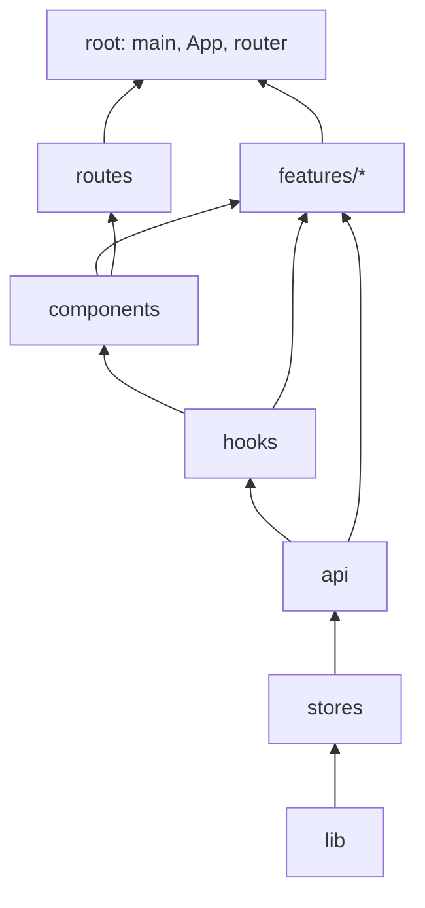

# Fase 1 — Reglas y red de seguridad (frontend)

> **Actualizado en la fase 3** ([fase-3-monorepo-y-herramientas.md](fase-3-monorepo-y-herramientas.md)): el frontend es
> un monorepo pnpm + Turborepo y la app vive en `apps/web`. Su `src/` se divide en `app/` (antes `root` y
> `routes`), `shared/<capa>` (antes `lib`, `stores`, `api`, `hooks`, `components`, `test`) y `features/*`. Las
> reglas de este documento siguen vigentes con esos nombres. Ya no las hace cumplir un test propio, sino
> **eslint-plugin-boundaries** y **ArchUnitTS** (sección 3). La matriz tiene una sola fuente:
> `packages/architecture/src/matrices.json`.

## 1. Capas permitidas

Cada zona puede importar de sí misma y de las de su fila. `root` (`main.tsx`, `App.tsx`,
`router.tsx`) arma la app y puede importar de todas.

| Zona | Puede importar de |
|---|---|
| `lib` | — (utilidades puras, sin red ni estado) |
| `stores` | lib |
| `api` | lib, stores |
| `hooks` | lib, stores, api |
| `components` | lib, stores, hooks |
| `routes` | lib, stores, api, hooks, components |
| `test` | lib, stores, api, hooks, components |
| `features/*` | lib, stores, api, hooks, components, test y las features permitidas abajo |

En el diagrama la flecha va **del que es usado al que lo usa** (de abajo hacia arriba).

## 2. Reglas entre features

- Una feature **no** importa de otra, salvo los pares de esta tabla.
- Cuando se permite, se entra **solo por el `index.ts`** de la feature, su API pública. Importar `../panel/PanelLayout` falla; hay que usar `../panel`.
- Si algo lo usan dos o más features y no es el shell de un layout, va a `components/`, `hooks/` o `lib/`, no a otra feature.

| Feature | Puede usar | Qué expone el `index.ts` |
|---|---|---|
| `admin`, `docente`, `coordinador` | `panel` | `PanelLayout`, `SeccionNav` |
| `home`, `panel` | `perfil` | `ConfiguracionModal` |

Los `vi.mock('…')` de los tests no cuentan: mockear un archivo interno es parte del test, no una dependencia.

## 3. Los chequeos y sus listas de deuda

| Chequeo | Herramienta | Dónde corre | Deuda |
|---|---|---|---|
| Límites entre capas, capas de `shared/`, matriz de features y entrada solo por `index.ts` | eslint-plugin-boundaries (`eslint/limites.mjs`) | `pnpm lint` y el editor | `apps/web/eslint-suppressions.json` |
| Lo mismo sobre todo el grafo, más ciclos entre features, mocks en producción, `shared/` con un solo dueño, reexportes de `shared/` y mocks de rutas internas | ArchUnitTS (`@simulaedu/architecture`) | `pnpm test` (`src/app/architecture.test.ts`) | `apps/web/src/app/architecture.baseline.txt` |
| La regla de ESLint sigue viva (bloquea lo prohibido) | ESLint API | `pnpm test` (`src/app/featureBoundaries.test.ts`) | — |
| Código, exports y dependencias sin uso | knip | `pnpm knip` | `knip.baseline.txt` |

Las tres listas solo pueden bajar: cada chequeo falla si aparece algo nuevo y también si algo de la lista ya se corrigió.
Cómo regenerarlas tras corregir está en `CLAUDE.md`.

| Momento | Violaciones |
|---|---:|
| Diagnóstico (Fase 0, test propio) | 32 |
| Tras la Fase 2 (test propio) | 3 |
| Fase 3, ArchUnitTS | 20 (las 3 de capas de `shared/`, 3 mocks de rutas internas y 14 módulos de `shared/` con un solo dueño, una regla nueva) |
| Fase 3, ESLint | 3 supresiones (las mismas 3 de capas de `shared/`) |
| Fase 3, knip | 31 hallazgos |
| Tras saldar la deuda (fase 3) | **0** en ArchUnitTS, **0** supresiones de ESLint y **1** en knip (alias intencional `subirImagenPregunta`) |

Las 3 de capas eran imports **de tipos** (`Usuario` y `TipoPrograma` desde `shared/api/`). Se resolvieron moviendo
esos tipos a `shared/lib/tipos/` (historia F2-05). Con las listas de ArchUnitTS y ESLint en cero, esas reglas ya
son estrictas en la práctica: cualquier violación hace fallar el lint o el test.

## 4. Vigente vs. objetivo

| | Vigente (lo exigen los chequeos) | Objetivo (adonde va el código nuevo) |
|---|---|---|
| Capas | Tabla de la sección 1, ninguna violación nueva | Igual, con el baseline en cero |
| Entre features | Solo los pares permitidos, por `index.ts` | Igual. Cada feature nueva arranca con su `index.ts` |
| Tipos del dominio | En `api/*Api.ts` | Los tipos que usan `lib` y `stores` pasan a `lib/tipos/` (sin red), y `api` los reexporta |
| Llamadas al backend | Solo desde `api/` (y los hooks y features que lo usan) | Igual |
