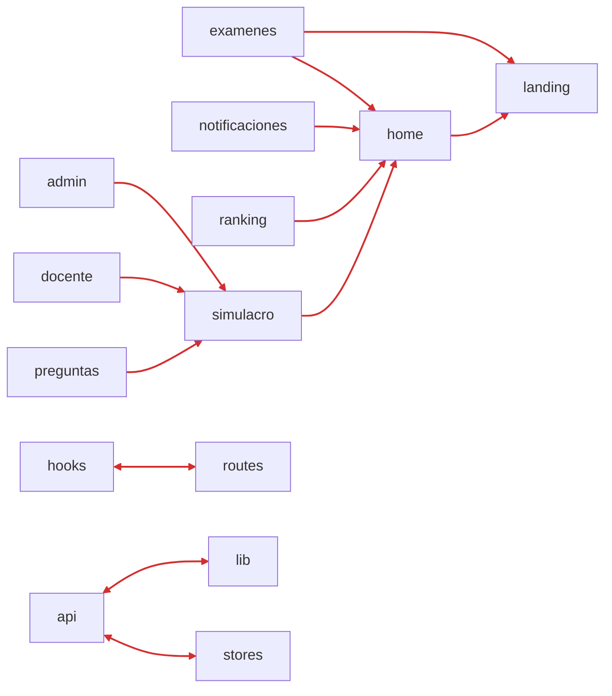
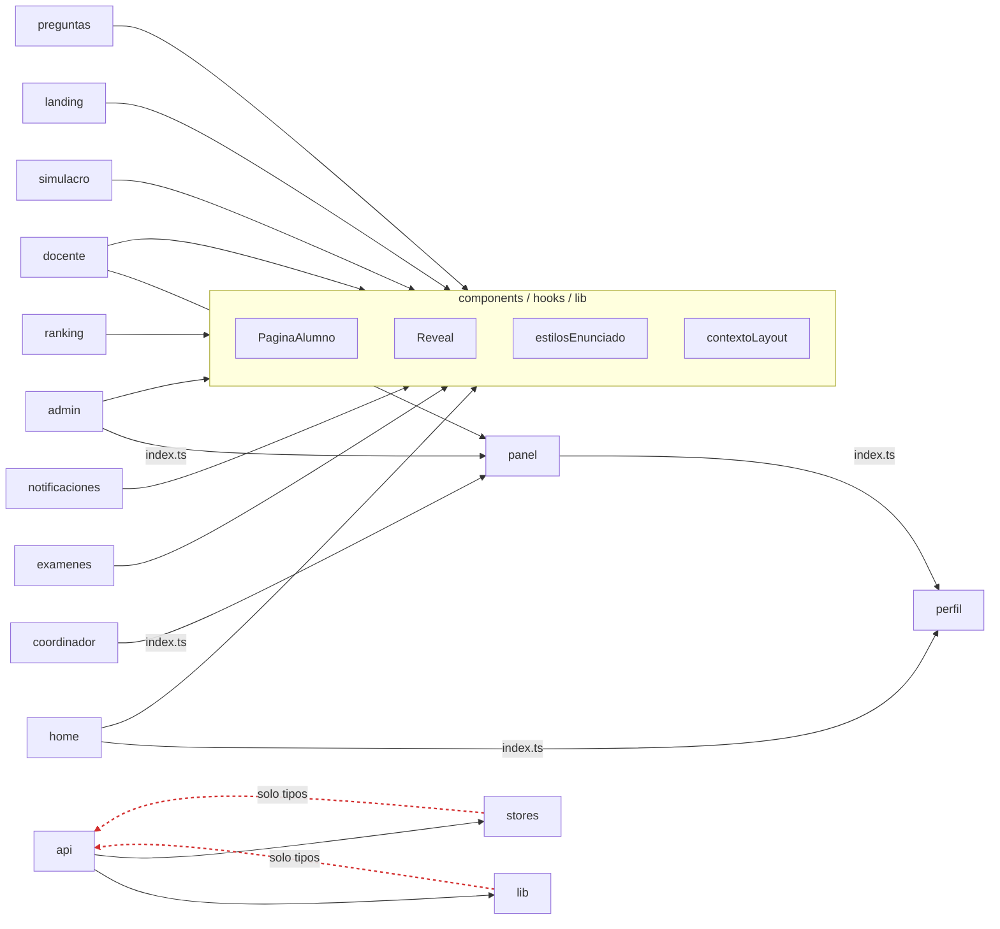

# Fase 2 — Compartidos fuera de las features (frontend)

Primera pasada de historias: mover lo compartido a su capa, dar API pública a las features que
otras usan y romper los ciclos `hooks ↔ routes` y `api ↔ lib`. No cambia ninguna pantalla, texto,
ruta ni llamada al backend: solo cambian rutas de archivos e imports.

> **Verificado** en la fase 3: `pnpm build` y `pnpm test` en verde, con los archivos ya en `apps/web/src/shared/`.

## 1. Qué se movió

| Historia | Antes | Después | Lo usan |
|---|---|---|---|
| F2-01 | `features/home/PaginaAlumno.tsx` | `components/PaginaAlumno.tsx` | home, examenes, notificaciones, ranking, simulacro |
| F2-01 | `features/landing/Reveal.tsx` | `components/Reveal.tsx` | landing, home, examenes |
| F2-01 | `features/simulacro/estilosSimulacro.ts` | `lib/estilosEnunciado.ts` | simulacro, admin, docente, preguntas |
| F2-02 | `routes/contextoLayout.ts` | `hooks/contextoLayout.ts` | `useNoLeidas`, home, notificaciones, `App.test` |
| F2-03 | `lib/sesion.ts` (+ `sesion.test.ts`) | `api/sesion.ts` (+ `sesion.test.ts`) | `api/client`, `hooks/useAuth`, `main.tsx` |
| F2-04 | — | `features/panel/index.ts` | admin, docente, coordinador |
| F2-04 | — | `features/perfil/index.ts` | home, panel |

Los `vi.mock('../landing/Reveal')` de los tests de `examenes` se actualizaron a
`'../../components/Reveal'`. Los mocks de `perfil/ConfiguracionModal` siguen funcionando porque el
`index.ts` reexporta ese mismo módulo.

## 2. Antes y después

**Antes:** 9 flechas entre features por UI compartida, 5 imports profundos y 3 ciclos entre zonas.

**Después:** las features solo se cruzan por `index.ts`. Quedan dos ciclos, y los dos son solo de tipos (punteados).

## 3. Deuda que queda e historias pendientes

Medido con el test propio `src/arquitectura.test.ts` (reemplazado en la fase 3): **3 violaciones** (antes 32).

### F2-05 · Tipos del dominio fuera de `api/` — 0,5 días · **hecha**
- **Problema:** `stores/authStore.ts` importa el tipo `Usuario` de `api/authApi.ts`, y `lib/programas.ts` importa `TipoPrograma` de `api/universidadesApi.ts`. Por eso `stores` y `lib` dependen de `api`, aunque sea solo por tipos.
- **Solución:** mover esos tipos a `lib/tipos/` (`usuario.ts`, `programa.ts`). `api/authApi.ts` y `api/universidadesApi.ts` los reexportan, así que ningún consumidor cambia.
- **Criterios de aceptación:** desaparecen las 3 líneas `capa-de-shared` de `apps/web/src/app/architecture.baseline.txt` y las 3 supresiones de `apps/web/eslint-suppressions.json`. `pnpm build` en verde.
- **Resultado:** `Usuario` y `TipoPrograma` viven en `shared/lib/tipos/` (`usuario.ts`, `programa.ts`). `shared/api/authApi.ts` y `shared/api/universidadesApi.ts` los reexportan, así que ningún consumidor cambió. Las 3 líneas `capa-de-shared` y las 3 supresiones de ESLint desaparecieron.

### F2-06 · Reglas en el lint (opcional) — 0,5 días · **hecha en la fase 3**
- **Problema:** el test avisa en `npm test`, no mientras se escribe.
- **Solución:** agregar `eslint-plugin-boundaries` con la misma matriz para tener feedback en el editor. El test se queda como fuente de verdad.
- **Criterios de aceptación:** `npm run lint` marca un import de `features/ranking` a `features/simulacro`.
- **Resultado:** `eslint/limites.mjs` (eslint-plugin-boundaries 7) con la matriz de `packages/architecture/src/matrices.json`; `pnpm lint` lo marca y `apps/web/src/app/featureBoundaries.test.ts` lo comprueba. Ver [fase-3-monorepo-y-herramientas.md](fase-3-monorepo-y-herramientas.md).

### F2-07 · `api/` por feature (evaluar) — 2 a 3 días · **hecha**
- **Problema:** `api/` es una capa horizontal con 25 archivos. Clientes que solo usa una feature, como `adminPlanesApi` o `coordinadorApi`, podrían vivir dentro de ella.
- **Solución:** mover a `features/<x>/api.ts` los clientes que usa una sola feature y dejar en `api/` los compartidos (`client`, `authApi`, `examenesApi`, `simulacrosApi`…).
- **Criterios de aceptación:** cada archivo de `api/` lo importan al menos dos zonas.
- **Resultado:** los 12 clientes de `shared/api/` con un solo dueño pasaron a su feature (`features/admin/admin*Api.ts`, `features/docente/{estadisticas,grupos,reportes,revisiones}Api.ts`, `features/coordinador/coordinadorApi.ts`, `features/landing/landingApi.ts`, `features/ranking/rankingApi.ts`), además de `BannerConexion` (a `app/`) e `InfoTooltip` (a `features/examenes/`). En `shared/api/` queda solo lo que usan dos o más features o `app/`; la regla `shared-con-un-solo-dueno` de ArchUnitTS lo mantiene así.
- **Nota:** cambia muchos imports sin arreglar ningún ciclo, así que es mejor decidirlo antes de hacerlo.
